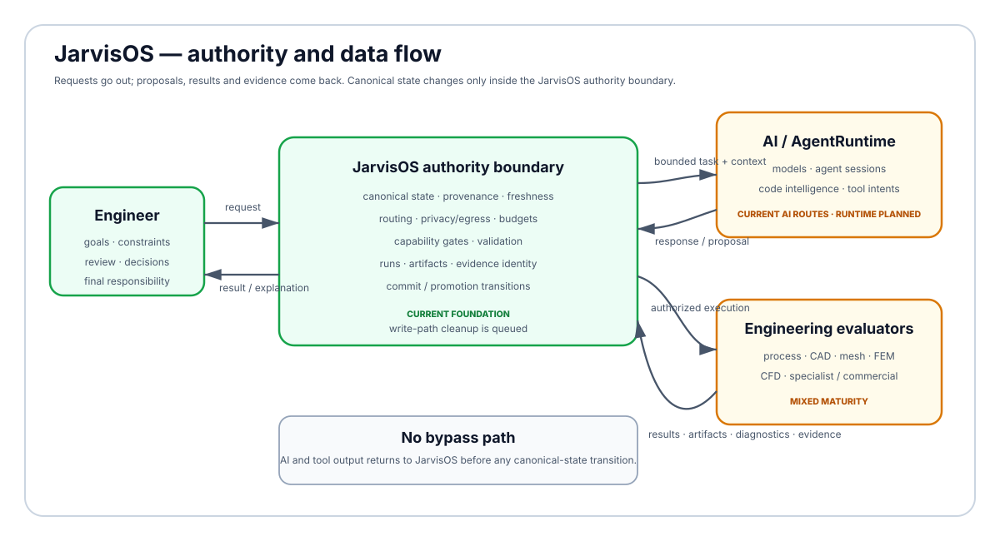
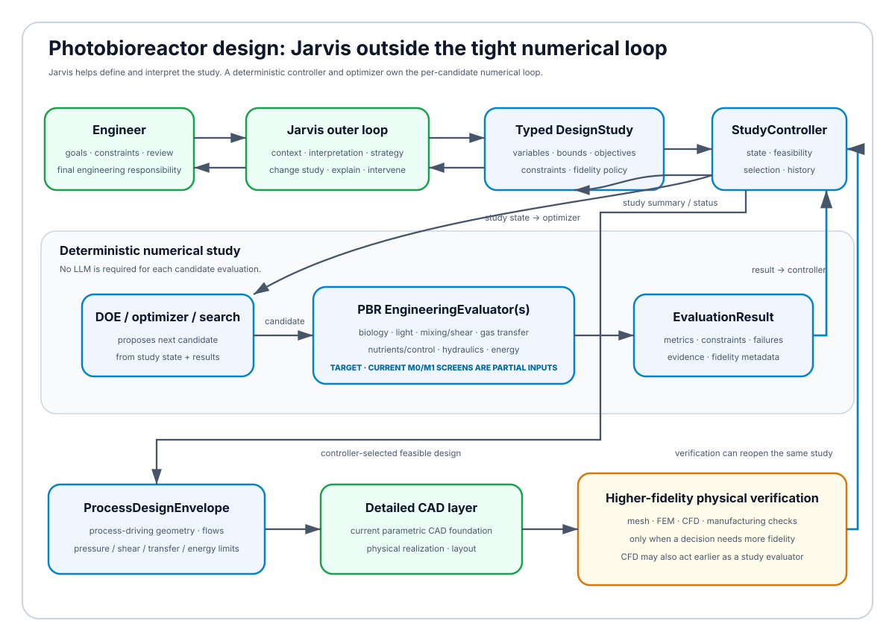

<h1 align="center">JarvisOS</h1>

<h3 align="center">An AI-powered engineering workstation, built by an engineer who doesn't code</h3>

<p align="center"><code>chemical engineering</code> · <code>CAD / CFD / process simulation</code> · <code>local-first AI</code> · <code>data sovereignty</code></p>

---

> **Source-available, work in progress.** The code is public for inspection and evaluation under the terms in
> [License](#license). This page explains what JarvisOS is, why it exists and what I have learned about what AI makes
> possible for engineers today.

## The question behind it

I'm a chemical engineer, not a software developer. A year ago I asked myself:

> **How far can an engineer with no coding background go, if he treats today's AI models as a development team and
> keeps his engineering judgement in charge?**

JarvisOS is my answer in progress: an engineering workstation (process simulation, parametric CAD, meshing, CFD, FEM,
project knowledge, and an AI assistant that lives inside the work) designed, specified, reviewed and tested by me, with
the code written by AI agents working under rules, tests and review gates that I set. A lot of the code has been produced
with substantial AI assistance; I do not want to disguise that, and I do not claim to have rebuilt HYSYS, ANSYS or a
frontier model by myself.



## Why I started

**1. Independence from expensive licences.** University licences end. COMSOL, ANSYS, Aspen and friends are excellent
and priced for large companies. I wanted to keep doing serious R&D without depending on them: using open engines
(OpenFOAM, Gmsh, CalculiX, DWSIM, build123d/OpenCASCADE) where they are good enough, and leaving the door open to
commercial tools where they are genuinely better. The goal is choice, interoperability and control, not "commercial bad".

**2. Data sovereignty.** Unpublished research, designs and IP shouldn't leave the machine just because an AI is useful.
JarvisOS runs local models on my own GPU by default and treats every use of a cloud model as an explicit, logged decision,
with sensitivity checks on what is sent.

**3. An experiment in empowerment.** Can AI give an engineer the leverage that used to require a software team? Not
"AI writes an app", but AI as the hands, and the engineer as architect, reviewer and owner of every decision.

The first serious use case is a microalgae photobioreactor R&D project. It mixes biology, hydraulics, gas transfer, light,
energy, process design and optimization, CAD and higher-fidelity physical verification, which is what exposed how
fragmented engineering software is.



## What it does today

- **Design workspace**: a plant flowsheet with a steady-state solver and solver console, component trees, versions and
  case studies, all on one shared project state.
- **Parametric CAD**: geometry generated from typed specifications and sandboxed scripts, exported to STEP/STL/GLB and
  inspected in a 3D viewer.
- **CFD and FEM**: OpenFOAM pipe-flow cases from geometry to mesh to results, with run comparison and reduced models
  published back into the process simulation; Gmsh meshing and CalculiX static FEM are under development.
- **Model workshop**: every engineering model shows its Python source next to its equations, rendered like a LaTeX paper
  and linked line by line.
- **Bubu, the assistant that points**: a small mascot that opens a chat bubble anywhere in the app. It reads the page,
  explains how to do things and draws arrows to the controls you need. It never clicks or changes anything on its own.
- **Governed AI**: local models for everyday work, frontier models through subscriptions for hard problems; every call is
  routed, budgeted and recorded. `route_class="auto"` never reaches an external provider, and credentials never reach the
  frontend.

## How it's built

I don't write the code. I write **specifications**: what a feature must do, how it will be tested, what it must never do.
A team of AI agents (different models from different companies, each with a defined role) implements, reviews and
verifies, through:

- written specifications and a single registry for what is open and what comes next (`docs/specs/STATUS.md`); hundreds
  have been delivered over the life of the project and are not kept in this repository;
- thousands of automated tests and continuous integration on every change, including a leak guard and generated-file
  drift checks;
- an autonomous supervisor that carries the roadmap forward, switches between AI providers when one runs out of quota,
  and stops to ask me whenever the effect of an action is uncertain.

The interesting part is not any single tool but making good existing tools cooperate inside a traceable engineering
workflow instead of living in separate programs, spreadsheets and AI chats. Where an established upstream project solves a
generic problem better (for example Hermes Agent for agent loops), the rule is to evaluate it first and integrate what
survives testing behind JarvisOS-owned boundaries for state, policy, credentials, egress and budget.

## Where it's going

A COMSOL-like workbench: direct 3D modelling in the viewport with a parametric history, full 3D CFD results views, FEM on
the same geometry, and an assistant that can turn "make a 50 mm tube two metres long and run the pressure drop" into a
reviewed sequence of steps. The engineer stays responsible for the engineering decision; JarvisOS should make that decision
better informed, easier to reproduce and less fragmented.

## Run it

Stack: Python, FastAPI and SQLite on the backend; React, TypeScript, Vite and Three.js on the frontend; build123d/OCP,
Gmsh, CalculiX and OpenFOAM for physical design.

```bash
python3 -m venv backend/.venv
backend/.venv/bin/pip install -r backend/requirements.txt -r backend/requirements-dev.txt
(cd frontend && npm ci)
cd backend && .venv/bin/python -m uvicorn app.main:app --host 127.0.0.1 --port 8000   # then, in frontend/: npm run dev
```

Details: [`docs/RUNBOOKS.md`](docs/RUNBOOKS.md). How the project is organised and worked on: [`AGENTS.md`](AGENTS.md),
[`docs/PROCESS.md`](docs/PROCESS.md), [`docs/ARCHITECTURE.md`](docs/ARCHITECTURE.md) and the generated module table
[`docs/MODULES.md`](docs/MODULES.md). Open work: [`docs/specs/STATUS.md`](docs/specs/STATUS.md).

## Collaboration

This is a personal experimental project, which is exactly why outside expertise is valuable: software and agent engineers,
process, mechanical and control engineers, researchers working on simulation, optimization or bioprocesses, and people
interested in open scientific-computing ecosystems. If you see a technical mistake or a tool I should evaluate instead of
rebuilding, **open an issue or get in touch through GitHub**. I am not looking to pretend the project is more mature than it
is.

## About me

Chemical engineering, Politecnico di Milano.

## License

This repository is **source-available for inspection and evaluation**; JarvisOS is **not distributed under an open-source
license**. Unless written permission says otherwise, the code remains all rights reserved. Discussion, critique and
collaboration are welcome; public availability is not permission to redistribute the code, build derivative products from
it or reuse it in another product.
